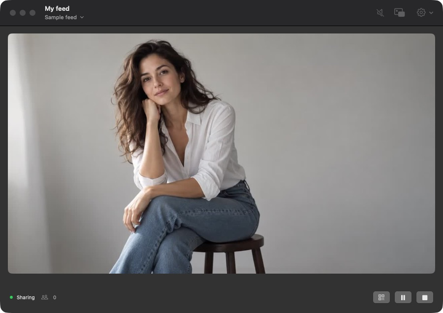

<div align="center">
  
  <h1>Setbeam</h1>
  <p><strong>Monitor on your Mac. Share with the set.</strong></p>
  <p>Receive a computer display or camera feed.<br>Give nearby viewers a link to watch in their browser.</p>
  <p>
    <a href="#get-started">Get started</a> &nbsp;·&nbsp;
    <a href="docs/getting-started.md">Setup guide</a> &nbsp;·&nbsp;
    <a href="docs/hardware-tests.md">Hardware tests</a>
  </p>
</div>

<picture>
  <source media="(prefers-color-scheme: light)" srcset="Assets/screenshots/main-light.jpg">
  <source media="(prefers-color-scheme: dark)" srcset="Assets/screenshots/main-dark.jpg">
  
</picture>

<p align="center"><sub>The real Mac app, shown with fictional sample media. Light and dark appearances.</sub></p>

## Keep watching. Choose what viewers see.

- Watch in the main window or a resizable floating preview above your other apps.
- Invite viewers with a QR code or link. No viewer app or account required.
- Use Hold to replace the shared picture with a holding screen and silence. Your local monitor keeps playing, even after you stop sharing.
- Reopen your last working source in private. Sharing starts when you choose.

## Get started

Setbeam is a developer preview for Apple Silicon and macOS 14 or later. It is not yet notarized or publicly released.

With the [build tools](docs/getting-started.md#build-from-source) installed, run:

```sh
scripts/build-runtime.sh
scripts/check.sh
scripts/build-app.sh
open build/Setbeam.app
```

Choose a source, or try the labeled sample. Click **Start sharing**, then invite viewers on your local network. The app bundles its media tools, so it needs no Homebrew installation to run.

## Connections

Direct Wi-Fi reception has been physically tested with the Accsoon CineView Master 4K on firmware 3.30 and a 1080p60 computer display. Other transmitters and physical capture hardware remain unverified.

RTSP, incoming RTMP, and Mac capture inputs are also implemented. This Mac's screen captures a selected local display, including the cursor and excluding Setbeam windows. It requires Screen Recording permission and has no sound. Native capture verification is pending permission on the development Mac.

[Setup guide](docs/getting-started.md) · [Test results](docs/hardware-tests.md) · [Current status and limits](docs/status.md) · [Architecture](docs/architecture.md)

---

Built on [Holly Share](https://github.com/titleunknown/holly-share) by Faini Made. The [original launcher](docs/upstream/README.md) remains available as a reference.

[MIT license](LICENSE) · [Third-party notices](THIRD_PARTY_NOTICES.md)
