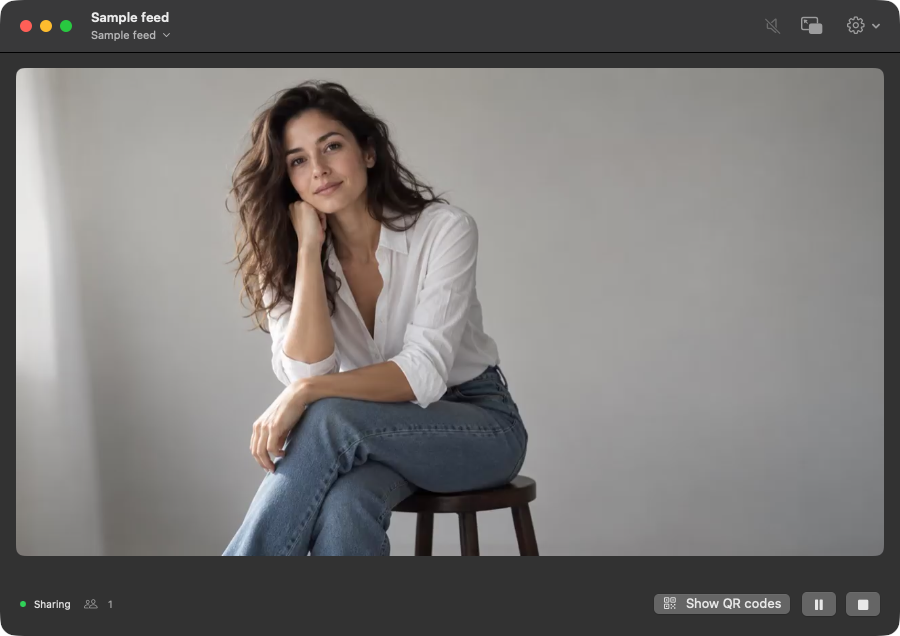
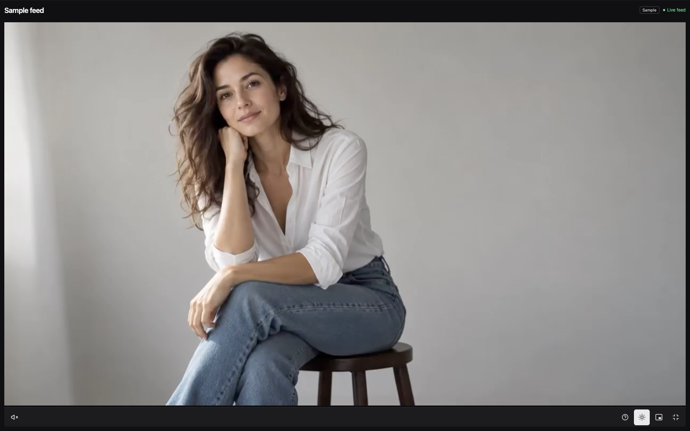
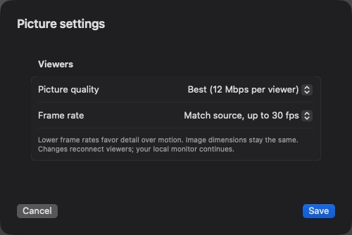

<div align="center">
  
  <h1>Setbeam</h1>
  <p><strong>Monitor on your Mac. Share with the set.</strong></p>
  <p>Receive a computer display or camera feed.<br>Give nearby viewers a link to watch in their browser.</p>
  <p><strong>0.2.0 · Build 20</strong> &nbsp; / &nbsp; Apple Silicon &nbsp; / &nbsp; macOS 14+</p>
  <p>
    <a href="https://github.com/austinpresley/setbeam/releases/download/v0.2.0-build20/Setbeam-0.2.0-build20-macOS-arm64.zip"><strong>Download for Mac</strong></a> &nbsp;·&nbsp;
    <a href="docs/getting-started.md">Setup guide</a> &nbsp;·&nbsp;
    <a href="docs/releases/0.2.0-build20.md">What's new</a>
  </p>
  <p><sub>Developer prerelease. Ad-hoc signed; not notarized.</sub></p>
</div>

<picture>
  <source media="(prefers-color-scheme: light)" srcset="Assets/screenshots/main-light.png">
  <source media="(prefers-color-scheme: dark)" srcset="Assets/screenshots/main-dark.png">
  
</picture>

<p align="center"><sub>The native Mac app in light and dark appearances. All pictures below use labeled, fictional sample media.</sub></p>

## Your picture stays on the Mac

Setbeam receives each source once. The main window, floating preview, and shared output use that same feed. Network video keeps its received encoding for local monitoring; the viewers' copy is encoded separately for browsers.

- Keep a resizable floating preview above your other apps. Zoom and pan to inspect detail.
- Share a QR code or viewing link. Viewers need a browser and access to the Mac's local network.
- Hold replaces outgoing source video with a holding screen and silence. Local monitoring continues through Hold and after Stop sharing.
- Set viewer frame rate and picture quality independently. Use 1 fps for still-image review, or up to 30 fps for motion. Mac screen capture has its own frame-rate control.
- Restore your last working source privately. Start sharing when you're ready.

<table>
  <tr>
    <td width="50%"></td>
    <td width="50%"></td>
  </tr>
  <tr>
    <td align="center"><strong>A browser is all viewers need.</strong><br><sub>A larger picture, full screen, and clear live, Hold, and reconnecting states.</sub></td>
    <td align="center"><strong>Choose detail and motion.</strong><br><sub>Viewer settings leave external-source local monitoring unchanged.</sub></td>
  </tr>
</table>

## Choose your source

- **This Mac's screen.** Select a display by name, resolution, and updating thumbnail. Includes the cursor, excludes Setbeam windows, and has no sound. Requires Screen Recording permission.
- **Accsoon CineView Master 4K.** Direct Wi-Fi reception physically tested with one firmware 3.30 unit and a 1080p60 computer display. See the exact [test scope and open checks](docs/hardware-tests.md).
- **Hollyland Pyro H.** Native discovery of the original launcher's RTSP route. Simulated discovery and H.264/AAC playback pass; physical Setbeam testing is pending.
- **Network stream or capture input.** Full-address RTSP, authenticated incoming RTMP, and detected Mac capture inputs. A connection type does not establish hardware compatibility.
- **Sample.** Try monitoring, sharing, and audience controls without a transmitter. Explicitly labeled throughout the app and viewer.

## Up and running

1. [Download build 20](https://github.com/austinpresley/setbeam/releases/tag/v0.2.0-build20), unzip it, and move **Setbeam.app** into Applications.
2. Open Setbeam and choose a source, or try the sample.
3. Click **Start sharing**, choose a viewing network your audience can reach, and share the QR code or link.

The app bundles its media runtime and needs no Homebrew installation to run. This prerelease is ad-hoc signed, so macOS may block the first launch. See the [installation guide](docs/getting-started.md#install-the-prerelease) for the normal macOS opening flow.

Viewing uses local HTTP and read-only session links. Use a trusted local network. Setbeam has no internet relay or viewer account service.

<details>
<summary><strong>Build from source</strong></summary>

Install the [build prerequisites](docs/getting-started.md#build-from-source), then run locally:

```sh
scripts/build-runtime.sh
scripts/check.sh
scripts/build-app.sh
open build/Setbeam.app
```

Hosted CI is disabled. Tests, builds, and packaging checks run locally.

</details>

## New since October 21

Mac screen capture and display previews. A redesigned browser viewer with optional names and playback health. Independent FPS and bitrate controls. GPU-backed native pictures and fixes for detailed 4K sharing. Persistent join codes, clearer network guidance, and native Pyro H discovery.

Read the [October 21–29 change notes](docs/releases/0.2.0-build20.md) for the complete scope, validation, and remaining limits. Physical Pyro H testing, long-session reliability, audible Mac output, wider device coverage, and Developer ID notarization remain open.

[Setup guide](docs/getting-started.md) · [Hardware evidence](docs/hardware-tests.md) · [Current status](docs/status.md) · [Architecture](docs/architecture.md)

---

Built on [Holly Share](https://github.com/titleunknown/holly-share) by Faini Made. The [original launcher](docs/upstream/README.md) remains available as a reference.

[MIT license](LICENSE) · [Third-party notices](THIRD_PARTY_NOTICES.md)
