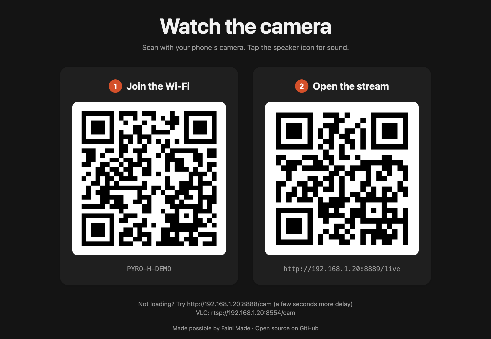
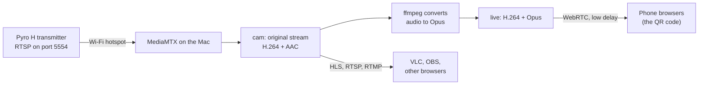

# Holly Share

This directory preserves the original Holly Share launcher and its supporting files as a reference. Setbeam's native app uses the source and build scripts at the repository root. The instructions below describe the original launcher.

Share the live video from a Hollyland Pyro H transmitter with anyone nearby. Run one thing on a Mac, and people watch in their phone's browser by scanning a QR code. No app, no account, no internet needed.



## What it does

- **Finds the transmitter for you.** It reads the address from the Mac's Wi-Fi and checks the usual RTSP ports, so there's nothing to look up or scan.
- **Serves many viewers at once.** The Pyro H serves one connection at a time. [MediaMTX](https://github.com/bluenviron/mediamtx) holds that one connection and re-serves the stream to everyone.
- **Plays in any phone browser, with sound.** Low-delay WebRTC playback, with the audio converted to Opus so browsers can play it.
- **Shows QR codes.** One opens the stream; an optional second one joins the phone to the right Wi-Fi. They appear in Terminal and on a page you can put on a screen, and are saved as a PNG to AirDrop or print.
- **Also gives you RTSP, RTMP and HLS links** for VLC, OBS or other software.
- **Lets you change the page's wording** by editing one HTML file, without touching the script.

## What you need

- A Mac running macOS (Apple Silicon or Intel)
- A Hollyland Pyro H transmitter. Other Hollyland models may work if you give the RTSP port with `--port`.
- [Homebrew](https://brew.sh), plus `ffmpeg`, `mediamtx` and `qrencode`. `Install.command` sets all of these up for you.

## Install

1. Get the code into a folder called `holly-share` in your home folder. Either:
   - Click **Code → Download ZIP** above, unzip it, rename the folder from `holly-share-main` to `holly-share`, and move it into your home folder (in Finder: Go → Home), or
   - In Terminal, run:
     ```bash
     git clone https://github.com/titleunknown/holly-share.git ~/holly-share
     ```
2. Double-click `Install.command`. It installs Homebrew if you don't have it (it asks first, and Homebrew asks for your Mac password), then the three tools.

> **"Apple could not verify…"?** Files downloaded from the internet are blocked the first time. Click **Done**, open **System Settings → Privacy & Security**, scroll down and click **Open Anyway**. Do the same the first time you open `Start Holly Share.command`. Or skip the double-click and run `bash ~/holly-share/Install.command` in Terminal.

## Use

1. Turn on the transmitter and join its Wi-Fi on the Mac.
2. Double-click `Start Holly Share.command`, or run `~/holly-share/holly-share.sh` in Terminal.
3. The first time, if macOS asks whether `mediamtx` may accept incoming connections, click **Allow**. Without it, phones can't connect.
4. A page with a QR code opens. Viewers scan it with their phone camera, then tap the speaker icon for sound.
5. To stop, press **Ctrl + C** in the Terminal window, or close it.

### Which network viewers join

Phones must be on the same network as the Mac. Terminal shows a `Sharing on` line:

- `en0` is usually the Mac's Wi-Fi. It means the Mac is only on the transmitter's hotspot, so phones join that hotspot too. It's 2.4 GHz and each viewer adds about 3 Mbps, so keep it to a few people.
- Any other name, such as a wired or USB network adapter, means phones join the normal Wi-Fi on that network. This handles more viewers.

To add a join-Wi-Fi QR code, give the name and password of the network viewers should join. The easy way, with no Terminal commands:

1. Start Holly Share once. It creates `holly-share.conf` in the `holly-share` folder.
2. Open `holly-share.conf` in TextEdit. On the `SSID=` and `WIFI_PASS=` lines, delete the `#` at the start and put in the network's name and password. Leave `WIFI_PASS=` empty for an open network.
3. Save, then start Holly Share again.

Or give them in Terminal:

```bash
~/holly-share/holly-share.sh --ssid "CAMERA-WIFI-NAME" --wifi-pass "PASSWORD"
```

### Options

Each option also has a line in `holly-share.conf`: `SSID`, `WIFI_PASS`, `IP`, `PORT` and `SHARE_IP`. An option typed in Terminal wins over the file.

| Option | What it does |
| --- | --- |
| `--ssid NAME --wifi-pass PASS` | Adds a join-Wi-Fi QR code as step 1 on the page |
| `--ip 192.168.218.10` | Sets the transmitter's address, if auto-detect fails |
| `--port 5554` | Sets the RTSP port, if it isn't 5554, 554 or 8554 |
| `--share-ip 10.0.0.42` | Sets the address viewers use (for example a Tailscale address, not yet tested) |
| `--no-open` | Doesn't open the QR page |
| `--help` | Shows these options |

### Addresses it serves

`<Mac IP>` is the address on the `Sharing on` line.

| Use | Address |
| --- | --- |
| Phones and browsers (low delay, the QR code) | `http://<Mac IP>:8889/live` |
| Browser fallback (HLS, a few seconds behind) | `http://<Mac IP>:8888/cam` |
| VLC or OBS (RTSP) | `rtsp://<Mac IP>:8554/cam` |
| RTMP | `rtmp://<Mac IP>/cam` |

## Change the page's text

The QR page comes from `share-page.html`. Open it in any text editor, change the heading, instructions, colours or footer, save, and start again.

- Keep the names in double curly braces, like `{{WATCH_QR}}` and `{{WATCH_URL}}`. The script swaps them for the QR codes and links. The comment at the top of the file lists them all.
- Anything with `class="wifi-only"` shows only when you use `--ssid`.
- Delete the file and the script writes the default back on its next run.

In TextEdit, first turn on **Settings → Open and Save → Display HTML files as HTML code instead of formatted text**.

## How it works



The transmitter runs a standard RTSP server on its own Wi-Fi hotspot. The script finds it at the hotspot's router address, starts MediaMTX to pull the stream once, and has ffmpeg make a second copy with Opus audio, because browsers can't play AAC over WebRTC. Video is never re-encoded, so it adds almost no delay or CPU load.

The step-by-step manual version, with stream measurements and more, is in [the full guide (PDF)](docs/hollyland-rtsp-guide.pdf).

## Troubleshooting

| Problem | Fix |
| --- | --- |
| `Missing: ffmpeg mediamtx qrencode` | Run `Install.command`, or `brew install ffmpeg mediamtx qrencode` |
| `command not found: brew` | Run the "Next steps" commands Homebrew printed at the end of its install, then open a new Terminal window |
| `permission denied` | Run `chmod +x ~/holly-share/*.command ~/holly-share/holly-share.sh` |
| `This Mac's Wi-Fi isn't on the transmitter's network` | Join the transmitter's Wi-Fi. Kits with a receiver have more than one Hollyland network, and only the transmitter's carries the stream |
| `No video stream found at …` | Check the Mac is on the transmitter's Wi-Fi, not the receiver's or your usual Wi-Fi. Close the Hollyland app on phones, since the transmitter allows one connection. If it still fails, turn the transmitter off and on. Other models may use another port: find it with `sudo nmap -p- -T4 --open <transmitter IP>`, then set `PORT` in `holly-share.conf` or pass `--port` |
| `Port … is already in use` | Holly Share is probably already running in another Terminal window. Close it. If that doesn't help, run `brew services stop mediamtx; pkill mediamtx` |
| Phones can't open the link | Put the phone on the same network as the `Sharing on` address, and allow `mediamtx` in System Settings → Network → Firewall |
| Picture but no sound on the phone | Browsers start muted. Tap the speaker icon |
| Picture breaks up | Move the Mac closer to the transmitter, or use a wired network for viewers |
| Stream freezes for a moment, and Terminal shows `connection reset by peer` | Something else connected to the transmitter. The Pyro H serves one connection at a time and drops the old one when a new one arrives. Connect VLC, OBS or other computers to the Mac's addresses, never straight to the transmitter. Holly Share reconnects by itself |
| Terminal shows `TCP timeout` or `i/o timeout` | The Mac lost the transmitter's Wi-Fi for a moment. Holly Share reconnects by itself. If it keeps happening, move the Mac closer to the transmitter |

## Tested with

Hollyland Pyro H, macOS 15 (Apple Silicon), MediaMTX 1.21, FFmpeg 9.0, qrencode 4.1, October 2026. Reports from other Hollyland models are welcome: open an issue with the model and the RTSP port.

## Contributing

Issues and pull requests are welcome. The script is plain bash and runs on the bash 3.2 that comes with macOS, so please keep it that way.

## License

[MIT](../../LICENSE) © 2026 Faini Made.

Holly Share installs and runs these tools but doesn't include them. Each has its own license: [FFmpeg](https://ffmpeg.org/legal.html) (LGPL/GPL), [MediaMTX](https://github.com/bluenviron/mediamtx) (MIT), [qrencode](https://fukuchi.org/works/qrencode/) (LGPL) and [Homebrew](https://github.com/Homebrew/brew) (BSD-2-Clause).

Hollyland and Pyro are trademarks of their owner. This project is independent and not affiliated with or endorsed by Hollyland.

---

Made possible by [Faini Made](https://fainimade.com)
